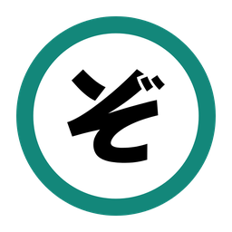

<div align="center">



<h1>Zoukan</h1>

**増刊 · A desktop manga reader for Windows and Mac**

[](https://github.com/JasperNg/zoukan/releases/latest)
[](https://github.com/JasperNg/zoukan/releases)
[](/LICENSE)

*Windows 10 or later (x64) · macOS on Apple Silicon*

</div>

Zoukan is a free and open source manga reader for the desktop. It is a port of
[Komikku](https://github.com/komikku-app/komikku), the Android reader based on
[Mihon](https://github.com/mihonapp/mihon) and [TachiyomiSY](https://github.com/jobobby04/TachiyomiSY),
to Windows and macOS. It runs the same extensions, reads the same backups and keeps the same
settings, so a library moves between a phone and a computer.

The name is the Japanese word for a magazine's special extra issue (増刊) which makes this the extra edition of
Komikku.

## Download

Get the installer for your computer from the [latest release](https://github.com/JasperNg/zoukan/releases/latest):

| Platform | File |
|---|---|
| Windows x64 | `Zoukan-<version>-windows-x64.msi` |
| macOS, Apple Silicon | `Zoukan-<version>-macos-arm64.dmg` |

## Features

**Library and reading**
- Library with categories, filters, sorts, badges and five display modes, including panorama covers
- Reader with paged (left to right, right to left), vertical, webtoon and continuous modes, zoom,
  crop borders, page splitting, filters and keyboard, mouse and wheel controls
- Updates and history tabs, statistics, and scheduled library updates with an update errors screen
- Downloads as CBZ or folders, with optional password-protected CBZs, and a local source that reads
  image folders, CBZ, ZIP, RAR, 7z and EPUB

**Sources**
- The extensions from Keiyoushi and other stores, installed and run as on Android
- Browse, global search, saved searches and the feed, with source and language icons
- A built-in Chromium browser for Cloudflare checks and site sign-in
- E-Hentai and ExHentai, MangaDex follows sync, and metadata views for supported sources
- Merged entries, migration between sources and source recommendations

**Your data**
- Backups in the `.tachibk` format: restore one from Komikku, Mihon or TachiyomiSY, and back up
  for any of them, by hand or on a schedule
- Trackers: MyAnimeList, AniList, Kitsu, MangaUpdates, Shikimori, Bangumi, Komga, Kavita and Suwayomi
- An encrypted database and encrypted logins, with keys in Windows Credential Manager or the macOS
  Keychain
- App lock, incognito mode and per-source incognito

**On the desktop**
- Tray or menu bar icon with notifications, and one window per profile
- Keyboard shortcuts across the app (Settings > Keyboard shortcuts)
- Discord Rich Presence

[desktop/PARITY.md](desktop/PARITY.md) compares Zoukan with the Android app feature by feature.

## Building

You need JDK 21. The Android SDK is not needed for the desktop app.

```bash
./gradlew :desktop:run                 # open the app
./gradlew spotlessCheck :desktop:build # format check, build and tests
./gradlew :desktop:packageInstaller    # MSI on Windows, DMG on macOS
```

On Windows use `.\gradlew.bat`. [desktop/README.md](desktop/README.md) covers the command line
tools, data folder, backups, tests and how the pieces fit. [desktop/RELEASING.md](desktop/RELEASING.md)
covers installers, signing, notarization and releases.

## Project layout

| Path | What |
|---|---|
| `desktop/` | The Zoukan app: Compose UI, reader, runtime, packaging |
| `extension-jvm/` | Installs and loads extensions on the JVM |
| `android-compat/`, `android-stubs/` | The Android APIs extensions and shared code expect, from [Suwayomi](https://github.com/Suwayomi/Suwayomi-Server) |
| `core/`, `data/`, `domain/`, `source-api/`, `backup/`, `i18n*/` | Code shared with the Android app |
| `app/` | Komikku's Android app, which shares the code above and still builds |

## Issues and contributing

Report a bug or suggest a feature with the [issue forms](https://github.com/JasperNg/zoukan/issues/new/choose).
Zoukan doesn't make or fix extensions, so take problems with a source to its extension's repository.
Pull requests are welcome: see [CONTRIBUTING.md](CONTRIBUTING.md) and the
[Code of Conduct](CODE_OF_CONDUCT.md).

## Credits

Zoukan is based on the work of [Komikku](https://github.com/komikku-app/komikku),
[Mihon](https://github.com/mihonapp/mihon) and Tachiyomi,
[TachiyomiSY](https://github.com/jobobby04/TachiyomiSY) and
[Suwayomi](https://github.com/Suwayomi/Suwayomi-Server), and of everyone who has contributed to them.

## Disclaimer

The developers of this application have no affiliation with the content providers available,
and this application hosts no content.

## License

    Copyright 2015 Javier Tomás

    Licensed under the Apache License, Version 2.0 (the "License");
    you may not use this file except in compliance with the License.
    You may obtain a copy of the License at

    http://www.apache.org/licenses/LICENSE-2.0

    Unless required by applicable law or agreed to in writing, software
    distributed under the License is distributed on an "AS IS" BASIS,
    WITHOUT WARRANTIES OR CONDITIONS OF ANY KIND, either express or implied.
    See the License for the specific language governing permissions and
    limitations under the License.

The Android compatibility layer in `android-compat/` comes from Suwayomi and is under the
Mozilla Public License 2.0.
